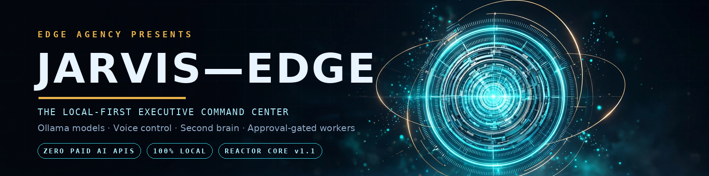
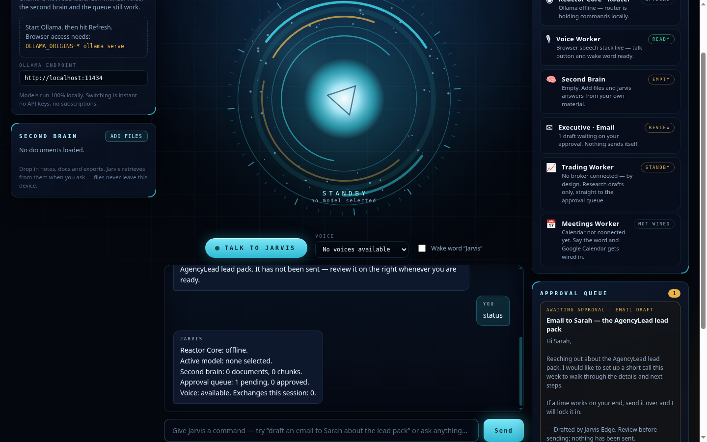
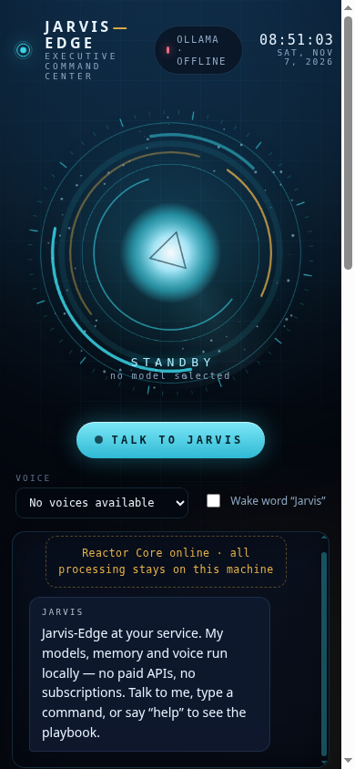
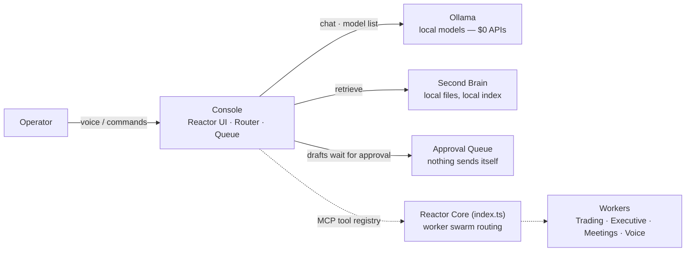
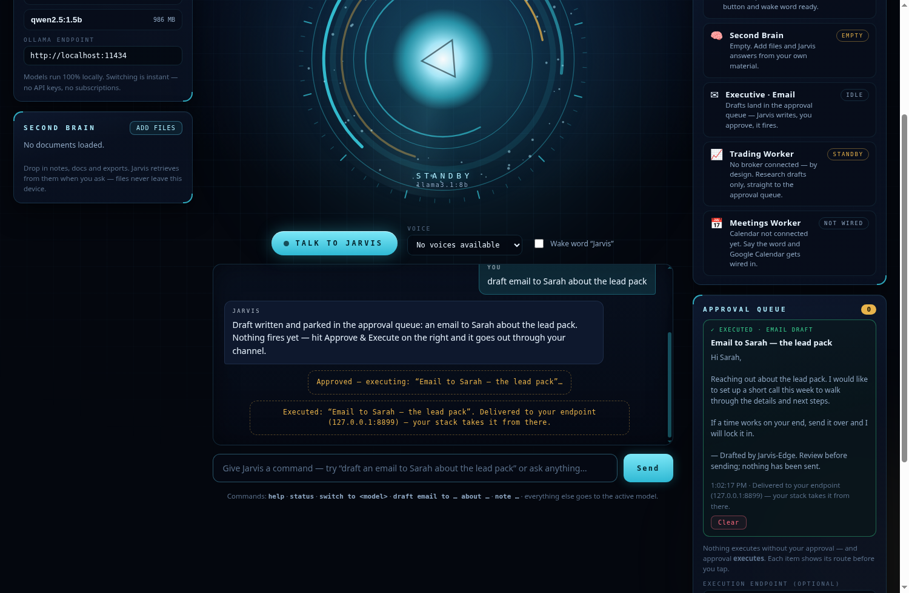
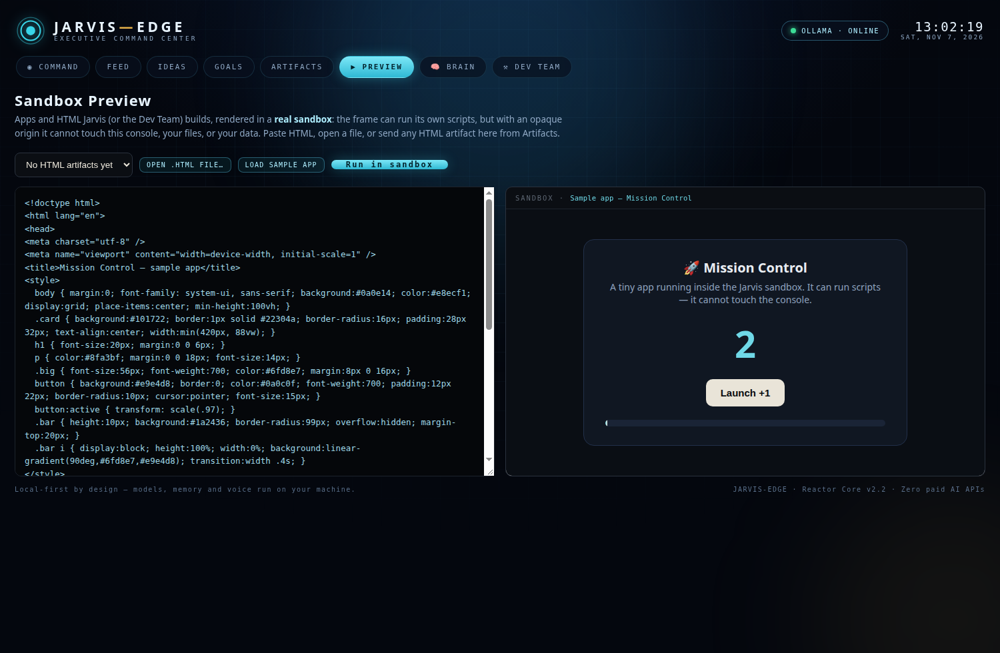

<div align="center">



# ⚡ Jarvis-Edge

### A Jarvis that runs on *your* machine — Ollama models, voice control, a second brain, and a worker swarm that never acts without your approval.

[](https://opensource.org/licenses/Apache-2.0)
[](https://github.com/EdgeAgent/jarvis-edge)
[](#)
[](#)

</div>

---

## 🌌 Why Jarvis-Edge exists

Most "AI assistants" rent you your own intelligence — a monthly toll on every
thought. Jarvis-Edge takes the other road: **free local models via Ollama, a
voice interface in the browser, your documents as a second brain, and one
hard rule — nothing is ever sent, posted, traded, or booked without a human
approving it first.**

The result is an executive command center you can run tonight, on hardware
you already own, for **$0/month in AI API costs**.

## 🖥️ The Console



| | |
| :--- | :--- |
| **Reactor Core visual** | A living canvas reactor that breathes with Jarvis — standby, listening, thinking, and speaking each carry their own state and colour. |
| **Local model rail** | Every model Ollama reports, listed with sizes. Tap to switch brains mid-conversation. Online/offline state is shown honestly, with the exact fix when Ollama is down. |
| **Voice control** | Push-to-talk plus an optional **"Jarvis" wake word**, and spoken replies in your choice of system voice (Chrome / Edge speech stack). |
| **Second brain** | Drop in `.md`, `.txt`, `.json`, `.csv`, `.log` files — chunked, indexed, and retrieved into answers on demand. Files never leave the device. |
| **Worker swarm** | Reactor Core router, Voice, Second Brain, Executive (email), Trading, and Meetings — each card reports its *real* state, including "not wired yet" where that's the truth. |
| **Approval queue** | Email drafts, reminders, and worker output wait here. Approve or dismiss — **the queue is the gate**, and approved items still stay local until you act on them. |
| **Command router** | `help` · `status` · `switch to <model>` · `draft email to … about …` · `note …` · `remind me …` — everything else streams from the active local model. |



## 🚀 Quick start

```bash
# 1 — install Ollama (ollama.com), pull a model, allow browser access
ollama pull llama3.1:8b
OLLAMA_ORIGINS=* ollama serve

# 2 — run the console
cd console
npm install
npm run dev        # http://127.0.0.1:5173
```

Full setup and operator notes: **[docs/CONSOLE.md](docs/CONSOLE.md)**.

## 🏗️ Architecture



| Component | Role | Status |
| :--- | :--- | :--- |
| **Console** (`console/`) | The operator interface described above | ✅ Working — verified end-to-end (router, queue, streaming chat, voice stack detection) |
| **Reactor Core** (`index.ts`) | MCP server that aggregates worker tools behind one interface, with a command whitelist and strict-mode approval flag | ⚠️ Skeleton — registry and gating in place, workers attach over time |
| **Browser Observer** (`server.py`) | FastAPI worker intended to audit browser sandboxes | 🧪 Stub — returns simulated audit values; not yet wired to the console |

## 📍 Roadmap

- Wire the Reactor Core's MCP registry into the console (workers become live services, not panels)
- Google Calendar for the Meetings worker (briefings + scheduling drafts to the queue)
- Local Whisper/Vosk voice option for a fully offline speech stack
- Real browser-observer implementation behind `server.py`
- One-command Docker stack (`docker-compose.yml`) for console + core

## 🔒 The standing rules

1. **Local first.** Models and memory run on the operator's machine.
2. **Approval is immutable.** No send, post, trade, or booking happens without a human yes — in the queue, every time.
3. **Honest states.** A worker that isn't connected says so, on its own card, in plain language.

## 📄 License

Apache 2.0 — see [LICENSE](https://opensource.org/licenses/Apache-2.0).

<div align="center">


**Built by Edge Agency — London, Ontario.**

</div>

## Console v2 — the workbench & the Dev Team

The console is now a full workbench: **Command** (chat + reactor), **Feed**
(everything Jarvis does, in order), **Ideas** (bank them, promote to goals),
**Goals** (steps + progress), **Artifacts** (finished work, downloadable),
and the **Dev Team** — a 12-agent agency bench (Lead, Research, Frontend,
Backend, Senior Dev, UI, UX, Content, SEO, Outbound, Code Reviewer, and a
Reality Checker) that runs missions in **parallel sandboxes** and files the
report to Artifacts and the approval queue. Personas adapted from the MIT
[Agency Agents](https://github.com/msitarzewski/agency-agents) library.
Proof: docs/assets/steps/step-09 (second brain answering from a loaded
document) and step-10 (a full mission, all seven sandboxes DONE).

It also ships as a **desktop app** (see desktop/): Electron shell, one-click
installers via GitHub Actions, and a **Windows tray icon** — close the
window and Jarvis stays on duty by the Wi-Fi/volume icons.


## ⚡ Console v2.2 — approval that executes · sandbox preview · motion

**Approve & Execute.** The approval gate is a trigger, not a vault. Every queue item shows the route it will take *before* you tap; hit **Approve & Execute** and it fires:

- **Execution endpoint set** (your n8n / Make / GoHighLevel / Hermes webhook): the item POSTs there as JSON (`queue.approved` — kind, title, body, timestamp) and **your stack does the sending** with your credentials. Jarvis never holds a mail password or API key.
- **No endpoint:** email drafts open composed in your own mail app, reminders fire a system notification, everything else saves to disk as a file.
- Outcomes are reported honestly — `✓ EXECUTED` with the delivery detail, or `✗ FAILED` with the reason and a re-run button. Nothing claims a send that didn't happen.



**Sandbox Preview.** A dedicated view renders apps and HTML artifacts in a genuinely isolated frame (`sandbox="allow-scripts"`, opaque origin): previewed code runs its own scripts and cannot touch the console, your files, or your data. Paste HTML, open a file, load the sample app, or send any HTML artifact from Artifacts with one click.



**Motion.** A tasteful anime.js layer (MIT) — views settle in, feed entries slide, executed items pulse. It respects `prefers-reduced-motion`, lazy-loads, and the console works identically if it never loads.
