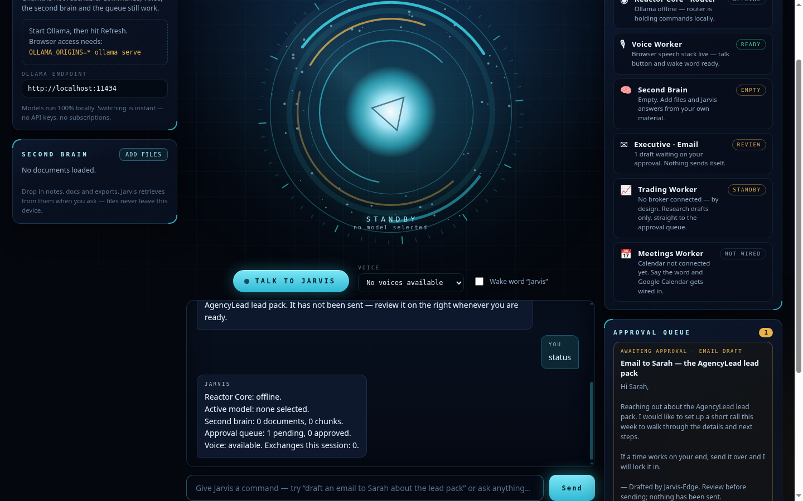
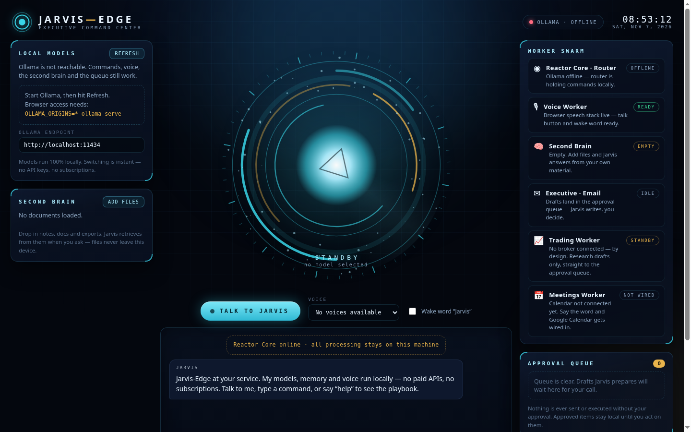
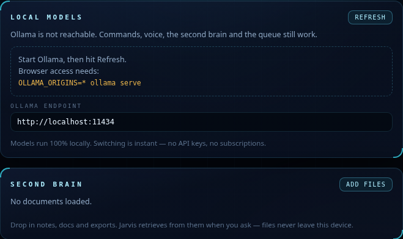
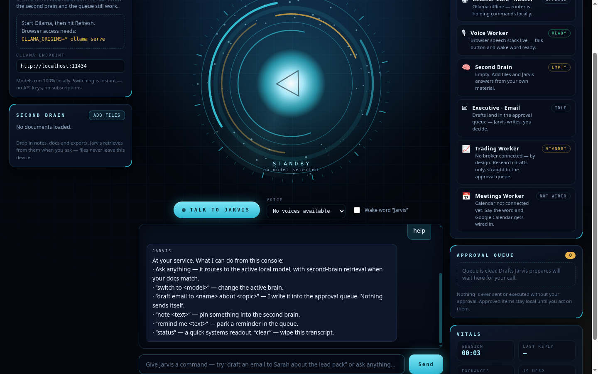
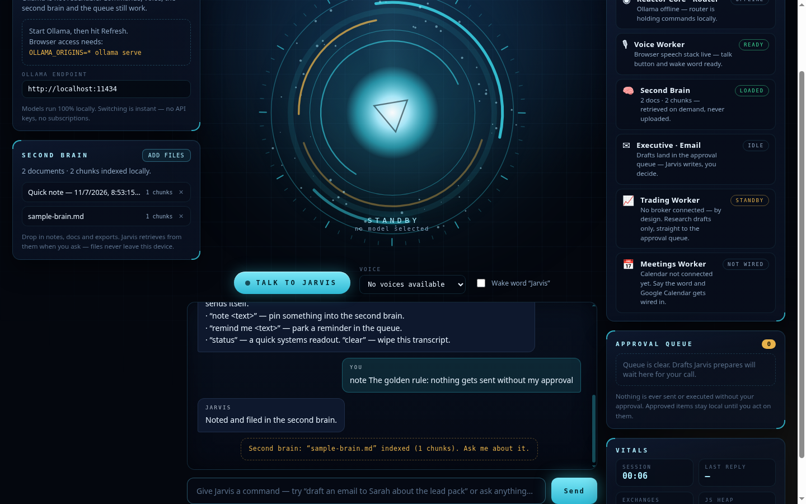
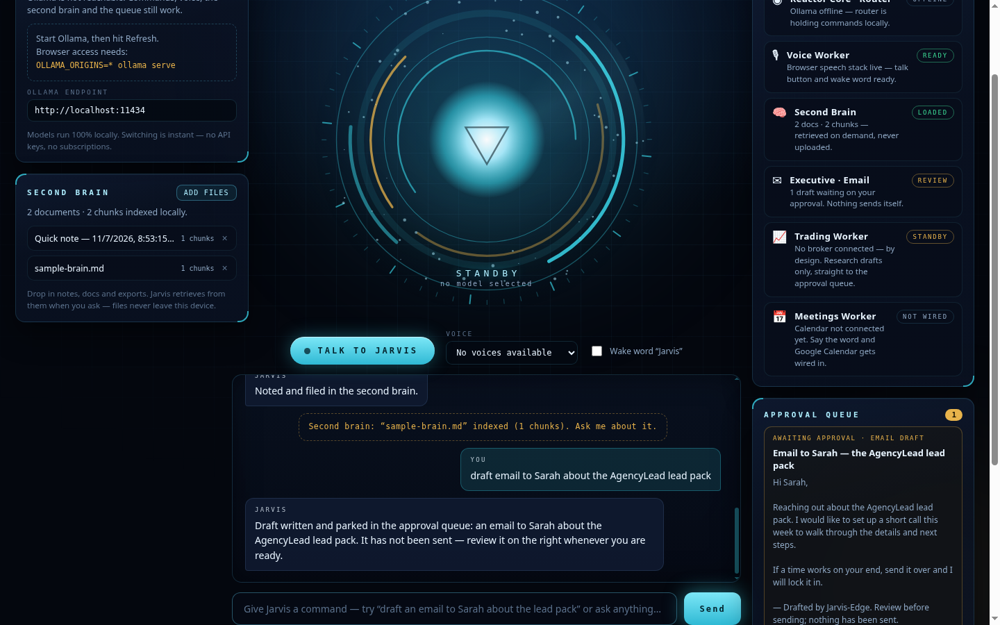
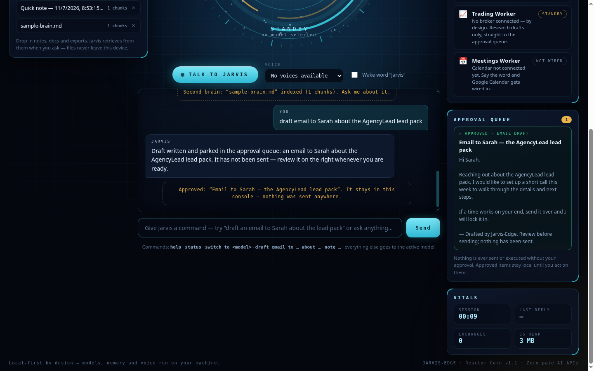
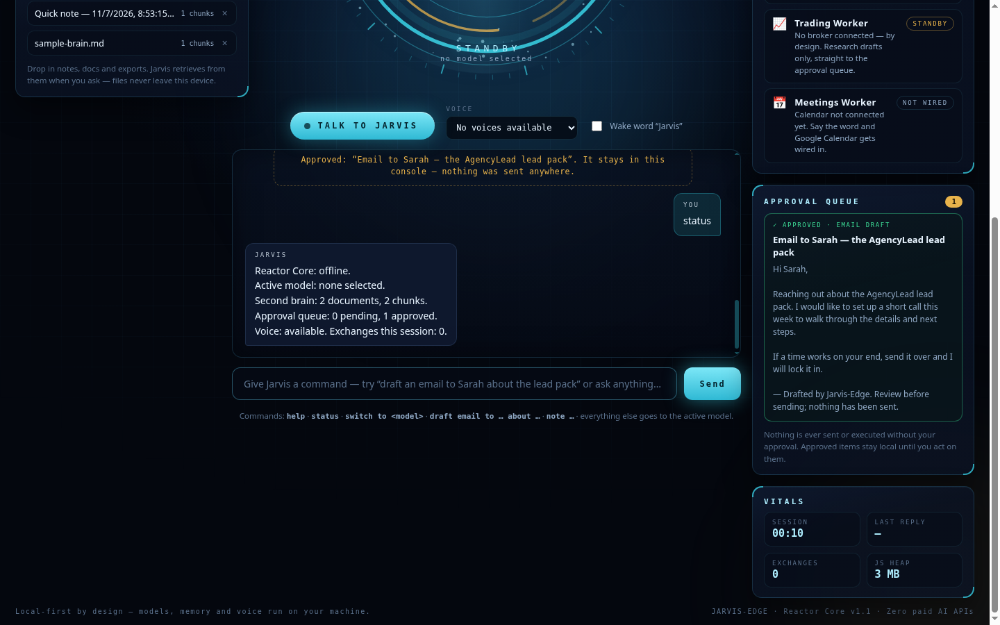

# JARVIS-EDGE — The Build Blueprint

### Build your own Jarvis. On your own computer. For $0 a month.

**A follow-along guide written in plain words — if you can install an app and copy-paste a line of text, you can build this.**


---

## 1. What you are building

You are building **your own Jarvis** — a talking AI assistant that lives on
*your* computer instead of in some company's cloud.

- It **thinks** using free AI models that run on your machine (no monthly bill).
- It **listens and talks** through your web browser.
- It **remembers your stuff** — your notes and files become its "second brain."
- It **does jobs for you** — like drafting emails — but it *never* sends or
  does anything final without you pressing approve. You are always the boss.

Here is the real thing, running. Every picture in this guide is a **real
screenshot** of the actual program — no mockups, no fakes.



*The command center: the glowing reactor in the middle is Jarvis. The left side
holds its brains and memory. The right side holds its workers and the approval
queue.*

---

## 2. Meet the 5 parts (the whole idea, in one minute)

Think of Jarvis like a person with five parts:

| Part | What it is | Plain-words version |
| :--- | :--- | :--- |
| 🧠 **The Brain** | An AI model run by a free program called **Ollama** | The thinker. It lives on your computer, not the internet. |
| 👂 **The Ears** | Your browser's speech recognition | How Jarvis hears you talk. |
| 🗣️ **The Mouth** | Your browser's speech voice | How Jarvis talks back. |
| 📚 **The Second Brain** | Your own files and notes | Jarvis reads your stuff so its answers are about *your* world. |
| ✋ **The Hands** | "Workers" — email, meetings, trading research | They prepare work… |
| ✅ **The Golden Rule** | The **Approval Queue** | …but nothing leaves the desk until **you** approve it. |

> **The Golden Rule is the whole point.** Other AI tools act first and say
> sorry later. Jarvis *prepares*, you *decide*. An email draft sits in the
> queue until you tap Approve — and even then it stays on your machine until
> you send it yourself.

---

## ⭐ Your quest map — the whole build on one page

Eight steps. Tick them off as you go — with a pen if you printed this.
Most people finish in about 30 minutes.

- [ ] **Step 1** — Install Ollama, the brain-keeper *(3 minutes)*
- [ ] **Step 2** — Download a brain (a model) *(5–10 minutes, mostly waiting)*
- [ ] **Step 3** — Let the browser talk to the brain *(2 minutes)*
- [ ] **Step 4** — Get the console and switch it on *(5 minutes)*
- [ ] **Step 5** — Say hello: your first commands *(5 minutes)*
- [ ] **Step 6** — Give Jarvis a voice *(5 minutes)*
- [ ] **Step 7** — Feed the second brain *(5 minutes)*
- [ ] **Step 8** — Run the approval queue *(3 minutes)*
- [ ] **Bonus** — Make it beautiful (Chapter 12) and Level up (Chapter 13)

**How the checklists work:** every step ends with a **✅ Checkpoint**
(what you should see) and a **Tick them off** list (every little action,
in order). If a box won't tick, the fix is in that step's checkpoint — or
in Chapter 14, *When stuff breaks*.


---

## 3. Before you start — the shopping list (everything is free)

You need:

- ☐ A computer — Windows, Mac, or Linux. A normal laptop is fine. (A stronger
  computer just means a smarter/faster brain — see the model sizes in Step 2.)
- ☐ **Google Chrome** or **Microsoft Edge** — free. (Voice features need one of
  these two browsers. Typing works in any browser.)
- ☐ About **30 minutes** and a coffee.
- ☐ **Zero dollars.** Every program in this guide is free.

You will download three free things along the way, and I will tell you exactly
when:

1. **Ollama** — the program that runs AI brains on your computer.
2. **Node.js** — a behind-the-scenes helper the console needs to run.
3. **The Jarvis-Edge files** — from the free code library (GitHub) in Step 4.

**Words you will see** (super short version — full glossary at the end):

- **Model** = the AI brain itself. Like a really well-read parrot that can reason.
- **Local** = on your computer. **Cloud** = on some company's computer.
- **Repo** = a public folder of code on GitHub, like a shared recipe book.
- **Terminal** = the window where you type commands to your computer directly.
  It looks hacker-ish. You only need to copy-paste what this guide gives you.

---

## 4. STEP 1 — Install the brain-keeper (Ollama)

1. Go to **ollama.com** and click **Download**. Pick your system
   (Windows / Mac / Linux) and install it like any normal app.
2. When it finishes, Ollama runs quietly in the background. On Windows it
   sits in the little tray by your clock. On Mac it's in the menu bar.

**✅ Checkpoint:** You installed it and saw no errors. That's it for now —
the next step gives it an actual brain.

**Tick them off:**

- [ ] Went to ollama.com and downloaded the installer for my system
- [ ] Installed it like a normal app, start to finish
- [ ] Ollama is running (tray icon on Windows / menu bar on Mac)

---

## 5. STEP 2 — Download a brain (a model)

A model is a file — usually 4 to 9 GB — that *is* the AI's knowledge. Bigger
usually means smarter but slower. Pick one to start:

| Model | Size | Good for |
| :--- | :--- | :--- |
| `llama3.1:8b` | ~4.7 GB | The all-rounder. Start here. |
| `qwen2.5:7b` | ~4.4 GB | Fast, sharp, great at following instructions. |
| `qwen2.5:14b` | ~9 GB | Noticeably smarter — needs a decent computer (16 GB RAM). |
| `phi4` | ~9 GB | Microsoft's brain — strong at reasoning and code. |

**How to download one:**

1. Open your **Terminal**:
   - **Windows:** press the Start button, type `Terminal`, press Enter.
   - **Mac:** press `Command + Space`, type `Terminal`, press Enter.
2. Copy this line, paste it into the Terminal, and press Enter:

   ```bash
   ollama pull llama3.1:8b
   ```

3. Wait for the progress bar to reach 100%. (Good moment for the coffee.)

**Want more than one brain?** Run the same line with another model's name.
Jarvis lets you swap brains with one tap — collecting two or three is normal.

**✅ Checkpoint:** The download finished and the Terminal says `success`.

**Tick them off:**

- [ ] Opened the Terminal
- [ ] Pasted `ollama pull llama3.1:8b` and pressed Enter
- [ ] The progress bar reached 100%
- [ ] The Terminal said `success`
- [ ] (Optional) Pulled a second brain to compare later

---

## 6. STEP 3 — Let the browser talk to the brain

Your browser and Ollama are both on your computer, but browsers have a
security rule: a web page may not talk to programs on your machine unless
the program says it's okay. So we start Ollama in "visitors welcome" mode:

1. In the Terminal, paste this line and press Enter:

   - **Windows (PowerShell):**
     ```powershell
     $env:OLLAMA_ORIGINS="*"; ollama serve
     ```
   - **Mac / Linux:**
     ```bash
     OLLAMA_ORIGINS="*" ollama serve
     ```

2. **Leave that Terminal window open.** It is Ollama's front door. If you
   close it, Jarvis can't reach the brain (and the console will tell you —
   see the Troubleshooting chapter).

**✅ Checkpoint:** The Terminal shows lines ending in `Listening on
127.0.0.1:11434`. That string of numbers is Ollama's home address on your
machine. Remember it — the console asks for it, and it's already filled in.

**Tick them off:**

- [ ] Pasted the `OLLAMA_ORIGINS` line for my system and pressed Enter
- [ ] The Terminal shows `Listening on 127.0.0.1:11434`
- [ ] I left that Terminal window OPEN (closing it closes the front door)

> **Safety note in plain words:** `OLLAMA_ORIGINS="*"` only matters on your
> own computer, for programs *already on your computer*. It does not put
> your Jarvis on the internet.

---

## 7. STEP 4 — Get the Jarvis-Edge console

The console is the pretty command center from the screenshots. Two ways to
get it — pick the easy one:

### The easy way (no Git knowledge needed)

1. Go to **github.com/EdgeAgent/jarvis-edge**
2. Click the green **Code** button → **Download ZIP**.
3. Unzip it somewhere you'll find it (your Desktop is fine). You now have a
   folder called `jarvis-edge`.

### The tidy way (if you know Git)

```bash
git clone https://github.com/EdgeAgent/jarvis-edge.git
```

### Start it

1. You need **Node.js** (the helper from the shopping list): download the
   "LTS" version from **nodejs.org** and install it like a normal app.
2. Open a Terminal **inside the console folder**:
   - The folder path is `jarvis-edge/console`.
   - Windows trick: open the folder, click the address bar, type `cmd`,
     press Enter — a Terminal opens already standing in that folder.
3. Paste these two lines, one at a time, pressing Enter after each:

   ```bash
   npm install
   npm run dev
   ```

   The first line downloads the console's parts (takes a minute). The
   second line switches it on.
4. Open **Chrome or Edge** and go to: **http://127.0.0.1:5173**



**✅ Checkpoint:** You see the reactor, the panels, and Jarvis's hello
message. **You just built a Jarvis.** Everything after this is learning to
use it and making it yours.

**Tick them off:**

- [ ] Downloaded the repo ZIP (or cloned it) and unzipped it
- [ ] Installed Node.js LTS from nodejs.org
- [ ] Opened a Terminal inside the `console` folder
- [ ] Ran `npm install` — it finished without red errors
- [ ] Ran `npm run dev`
- [ ] Opened http://127.0.0.1:5173 in Chrome or Edge
- [ ] I can see the reactor, the panels, and Jarvis's hello message
- [ ] The pill (top right) tells me whether Ollama is ONLINE or OFFLINE

> **The top-right pill tells the truth.** Green `OLLAMA · ONLINE` means the
> brain is connected. Red `OLLAMA · OFFLINE` means Step 3's Terminal got
> closed — reopen it and click **Refresh** in the Local Models panel.
> Here is that panel up close — it even prints the fix for you:
>
> 

---

## 8. STEP 5 — Say hello (your first commands)

The long box at the bottom is where you give orders. Type in it and press
**Send** (or Enter). Try these, in order:

### `help`

Type `help` and Send. Jarvis lists everything it can do:



### Ask a real question

With a model connected (green pill), type any question — *"Explain a
mortgage like I'm ten"* — and watch the answer stream in word by word.
The glowing reactor changes colour while Jarvis thinks and speaks.

### Swap brains

Type:

```text
switch to qwen2.5:7b
```

(or tap the model's name in the **Local Models** panel). The new brain
answers the next question. Different brains have different personalities —
try the same question on two and compare.

### The five magic commands

| You type | Jarvis does |
| :--- | :--- |
| `status` | Gives a one-glance health report of everything |
| `time` | Tells you the time and date (works even with no brain connected) |
| `note <anything>` | Pins a note into the second brain (next chapter) |
| `remind me <anything>` | Parks a reminder in the approval queue |
| `clear` | Wipes the conversation window clean |

**✅ Checkpoint:** `help` worked, and one real question got an answer from
your local model. No account. No bill. That answer cost you $0.

**Tick them off:**

- [ ] Typed `help` and read the playbook
- [ ] Asked one real question and watched the answer stream in
- [ ] Swapped brains — `switch to <model>`, or tapped one in the left panel
- [ ] Ran `status` and understood every line of the report

---

## 9. STEP 6 — Give Jarvis a voice

1. Click **TALK TO JARVIS**. The first time, the browser asks *"Allow
   microphone?"* — click **Allow**. (No allow = no ears. You can change
   your mind later: click the little lock/tune icon beside the web address
   → Site settings → Microphone → Allow.)
2. The button turns gold and says **LISTENING**. Say a command out loud —
   *"Jarvis, draft an email…"* works, but so does any plain question.
3. Jarvis **talks back** out loud. Pick the voice you like in the **Voice**
   dropdown beside the button — your computer already owns several.
4. Want hands-free? Tick **Wake word "Jarvis"**. Now just say
   *"Jarvis, what time is it?"* whenever you like. (Chrome/Edge keep
   listening while the tab is open.)

**What the reactor is telling you:** cyan = ready · gold = listening ·
violet = thinking · teal = speaking. After a day it reads like a face.

**✅ Checkpoint:** You had a spoken conversation with an AI that lives in
your house and answers to nobody else. The movie prop is real, and it's
yours.

**Tick them off:**

- [ ] Clicked TALK TO JARVIS and allowed the microphone
- [ ] Saw the button turn gold and say LISTENING
- [ ] Said a command out loud — and Jarvis did it
- [ ] Jarvis spoke the answer back to me
- [ ] Picked a voice I like in the Voice dropdown
- [ ] (Optional) Ticked the "Jarvis" wake word and tried it hands-free

> **Honest note about voices:** the talking (mouth) is 100% your computer.
> The listening (ears) in Chrome uses Google's speech service inside the
> browser — that's how Chrome is built. If you want ears that never touch
> the internet either, the Level Up chapter shows the fully-local options
> (Whisper and Piper). The blueprint hides nothing.

---

## 10. STEP 7 — Feed the second brain

A fresh AI knows the whole internet and *nothing about you*. The second
brain fixes that.

### Pin a note (10 seconds)

Type:

```text
note The golden rule: nothing gets sent without my approval
```


Jarvis files it. From now on, that note is part of what it knows.

### Add your real files

1. Click **Add files** in the **Second Brain** panel.
2. Pick files — notes, documents, lists, exports. Supported types:
   `.md` `.txt` `.json` `.csv` `.log`
3. Each file gets chopped into bite-size pieces ("chunks") and indexed
   **on your machine**. Nothing is uploaded anywhere. Ever.



*Two documents in, the Second Brain worker card flips to LOADED.*

### Ask about your stuff

Now ask: *"What are my prices?"* or *"What is the golden rule?"* — when
your question matches your files, Jarvis quietly slips the matching pages
to the brain before it answers, so the answer comes from **your** material.

**Try this starter pack of files:** your price list, your business hours,
your house rules, a "facts about me" page, your project notes. Five small
files turn a generic AI into *your* assistant.

**✅ Checkpoint:** The Second Brain panel shows your documents, and Jarvis
answered one question using them.

**Tick them off:**

- [ ] Pinned a note with `note …` and saw it filed
- [ ] Clicked **Add files** and loaded at least one real document
- [ ] The Second Brain worker card flipped to LOADED
- [ ] Asked a question my file answers — and Jarvis answered from *my* material

---

## 11. STEP 8 — The approval queue (the Golden Rule, in action)

1. Type:

   ```text
   draft email to Sarah about the AgencyLead lead pack
   ```

   (Use any name and any topic — yours will differ, and that's the point.)



2. Look right: the draft is sitting in the **Approval Queue**, stamped
   *AWAITING APPROVAL*. The **Executive · Email** worker card flips to
   *REVIEW* — "1 draft waiting on your approval. Nothing sends itself."
3. Read the draft. Then choose:
   - **Approve** — you're happy with it. It turns green and stays *in the
     console, on your machine*. Copy it into your real email app when
     you're ready. Jarvis still hasn't sent anything.
   - **Dismiss** — it's gone.



4. Type `status` any time for the full picture:



**That queue is the difference between a tool and a liability.** Every
worker Jarvis gains — email, meetings, research — reports to that queue
first. You stay the boss of everything that leaves your desk.

**✅ Checkpoint:** You drafted, reviewed, and approved (or dismissed) a
piece of work without anything being sent. Blueprint complete — Jarvis is
built. The rest of this guide is making it *beautiful* and *stronger*.

**Tick them off:**

- [ ] Drafted an email with `draft email to … about …`
- [ ] Saw it land in the Approval Queue, stamped AWAITING APPROVAL
- [ ] Actually read the draft before deciding (boss habit #1)
- [ ] Approved it or dismissed it — my call, nobody else's

### 🎓 The final check — is your Jarvis *really* done?

- [ ] Ollama is installed and a model is downloaded (run `ollama list` to see it)
- [ ] The console opens and the pill says OLLAMA · ONLINE
- [ ] I can switch between two models
- [ ] Jarvis hears me *and* talks back
- [ ] The wake word works while the tab is open
- [ ] My second brain holds at least one note and one file
- [ ] Jarvis answered a question using my own material
- [ ] A draft sat in the queue until **I** decided its fate
- [ ] I know the fix for the red OFFLINE pill (Chapter 14)
- [ ] I know the golden rule by heart: **the human approves**

Every box ticked? Then you didn't just read about AI — you *own* one.


---

## 12. Make it beautiful — the UI/UX recipe

"UI" is how it looks. "UX" is how it feels to use. The console you're
running follows a recipe you can steal for any project:

### The recipe

- **One hero, centre stage.** The reactor *is* the product. Everything
  else is a frame around it. When everything shouts, nothing does.
- **A tiny colour palette, used with discipline.** Deep navy background
  `#04070E` · reactor cyan `#39D5E8` · soft ice `#AEEFFF` · one gold
  `#E8B34B` reserved for *human decisions* (the queue, the listening
  state). Gold means "your call" — everywhere, every time.
- **Glass panels.** Dark blue, slightly see-through, thin glowing edges,
  little corner ticks. Information lives in panels; the background stays
  quiet.
- **Mono font for labels, normal font for people.** Machine words
  (`APPROVAL QUEUE`, `OLLAMA · ONLINE`) in spaced-out monospace; anything
  a human reads in a friendly sans. The contrast is the style.
- **Every state tells the truth, in words.** Not "error 0x3F" — *"Ollama
  is not reachable. Start Ollama, then hit Refresh"* plus the exact line
  to paste. Beautiful *and* honest beats beautiful.
- **Motion means something.** The reactor breathes when idle, swells when
  it hears you, changes colour by state. No decoration that lies.

### The parts bin — free UI/UX repos the pros actually use

A "repo" is a free public code library. These are the shelves this
console's look comes from, and where you go to build your own version.
Stars = how many builders bookmarked it (a rough "how trusted is this"
number). License = the rules for using it; **MIT and Apache-2.0 mean
"use it, even in products you sell." AGPL means "share your changes if
you distribute it"** — fine for personal use, read up before selling
something built on it.

| Repo | ⭐ Stars | License | What it's for, in plain words |
| :--- | :--- | :--- | :--- |
| [shadcn/ui](https://github.com/shadcn-ui/ui) | ~127,000 | MIT | Beautiful ready-made buttons, panels, and forms you copy into your app and own outright. The modern standard. |
| [Magic UI](https://github.com/magicuidesign/magicui) | ~23,000 | MIT | Animated, glowing, "wow" components — the shelf to raid when you want the jaw-drop factor. |
| [Tremor](https://github.com/tremorlabs/tremor) | ~3,700 | Apache-2.0 | Dashboard charts and stat cards. When your Jarvis needs graphs, start here. |
| [Open WebUI](https://github.com/open-webui/open-webui) | ~158,000 | Check its LICENSE file | A complete, polished chat face for Ollama. Study how the biggest project does it — or run it beside the console. |
| [AnythingLLM](https://github.com/Mintplex-Labs/anything-llm) | ~68,000 | MIT | A full local AI workspace with document brains. The reference design for second-brain UX. |
| [Khoj](https://github.com/khoj-ai/khoj) | ~38,000 | AGPL-3.0 | A second brain that reads your docs and the web. Great ideas to borrow for memory features. |

**How a beginner uses this table:** don't try to swallow a whole repo.
Open one, look at its screenshots, find the *one* component you love
("that glowing button"), and copy that idea into your build. That's what
professionals do. They just don't admit it at conferences.

---

## 13. Level up — where to go next

Finished the build and hungry? In rough order of payoff:

1. **A smarter brain.** Pull `qwen2.5:14b` or `phi4` and feel the jump.
   Same console, one command: `ollama pull qwen2.5:14b`.
2. **Fully local ears.** [Whisper](https://github.com/openai/whisper)
   (~112,000 ⭐, MIT) turns speech into text on your machine — pair it
   with the console to cut the browser's speech service out entirely.
3. **A better mouth.** [Piper](https://github.com/rhasspy/piper)
   (~11,000 ⭐, MIT) is a fast local voice that sounds human — the
   natural upgrade from built-in system voices.
4. **A voice that sounds like *you*.**
   [VoiceStudio](https://github.com/debpalash/VoiceStudio) (~103,000 ⭐,
   AGPL-3.0) does fully-local voice cloning — it's the tool featured in
   the video that inspired this build. (AGPL: personal use is fine; if
   you sell something built on it, its license asks you to share your
   code changes.)
5. **A calendar.** The Meetings worker is a panel today; the roadmap
   wires Google Calendar so briefings and scheduling drafts land in the
   approval queue like emails do.
6. **Run it everywhere.** The console is a web app: it works on your
   phone's browser on your home network, and the production build
   (`npm run build`) can be hosted anywhere static files live.

---

## 14. When stuff breaks (it will — here's the fix)

| What you see | What it means | The fix |
| :--- | :--- | :--- |
| Red pill: `OLLAMA · OFFLINE` | The Step 3 Terminal was closed, or Ollama isn't running | Start Ollama again with the `OLLAMA_ORIGINS` line from Step 3, then click **Refresh** |
| "No models installed yet" | Ollama is alive but brainless | `ollama pull llama3.1:8b` (Step 2) |
| The Talk button says voice isn't supported | You're not in Chrome/Edge | Open the same address in Chrome or Edge; typing works everywhere |
| Mic blocked / nothing heard | The browser denied the microphone | Lock/tune icon by the address bar → Site settings → Microphone → Allow, then reload |
| Voice dropdown says "No voices available" | Your system has no speech voices loaded yet | Reload the page; on Windows, add a voice in Settings → Speech |
| Jarvis answers, but ignores your files | The question's words don't match your documents' words | Ask using words that appear in the file, or add a clearer note with `note …` |
| `npm` is not recognized | Node.js isn't installed (or Terminal opened before install) | Install Node.js LTS from nodejs.org, then open a **new** Terminal |
| Port already in use | Another program grabbed 5173 | Close the other thing, or run `npm run dev -- --port 5174` and use that number in the address |

**The universal fix:** read the screen. This console was built to tell
you the truth in plain words — the answer is usually printed right where
the problem showed up.

---

## 15. The golden rules (tape these to the wall)

1. **Your machine, your rules.** Models and memory stay local. If a
   feature wants your data on someone else's computer, it has to say so
   out loud — like the voice note in Step 6 does.
2. **Nothing acts without approval.** Drafts queue up. Humans decide.
   Any tool that skips this rule doesn't get installed twice.
3. **Never paste passwords or keys into chat windows** — Jarvis's or
   anyone's. Real tools have proper sign-in pages; chat is not one.
4. **Small steps, checked often.** Every chapter here ended with a
   checkpoint on purpose. Build one piece, see it work, then continue.
5. **Honest labels.** If a part is a demo, it says demo. If a worker
   isn't connected, its card says so. Trust is the product.

---

## 16. Words to know (the whole glossary)

| Word | What it actually means |
| :--- | :--- |
| **AI model** | A big file of learned patterns — the "brain." Bigger file ≈ more learned, slower thinking. |
| **Ollama** | The free program that runs AI models on your computer and serves them to your apps. |
| **Local / localhost / 127.0.0.1** | Your own computer. `127.0.0.1` is its home address — mail that never leaves the house. |
| **API** | A doorway programs use to talk to each other. "Paid API" = a doorway with a toll booth. This build has no toll booths. |
| **Token** | A chunk of a word. Models read and write in tokens; speed is measured in tokens per second. |
| **Streaming** | The answer arriving word-by-word as it's thought, instead of all at once at the end. |
| **Second brain** | Your files and notes, organized so the AI can look things up in them. |
| **Chunk** | A bite-size piece of a document (a few paragraphs) — the size the brain can hold in mind at once. |
| **Repo / repository** | A public folder of code on GitHub, with its history. Downloading one is like photocopying a recipe book. |
| **Terminal** | The text window for ordering your computer directly. Copy-paste is a complete skill set here. |
| **npm** | The parts-delivery service for JavaScript programs. `npm install` = "deliver the parts list." |
| **UI / UX** | UI = how it looks. UX = how it feels to use. Good UX is why this guide has checkpoints. |
| **License (MIT / Apache / AGPL)** | The permission slip attached to free code. MIT/Apache: use freely, even commercially. AGPL: share your changes if you pass it on. |
| **Wake word** | The spoken name ("Jarvis") that tells the assistant to start listening. |

---

## 17. Pass it on

This blueprint and the console it builds are **free for everybody**:

- The code lives at **github.com/EdgeAgent/jarvis-edge** under the
  **Apache 2.0** license — use it, change it, build on it.
- Share this guide with anyone who thinks AI has to come with a monthly
  bill. It doesn't. It comes with a download, thirty minutes, and a
  golden rule: *the human approves.*

**Built by Edge Agency · London, Ontario · github.com/EdgeAgent**
